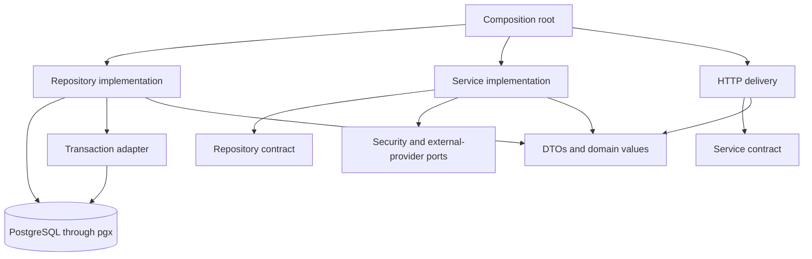

# Architecture

## Decisions

GoStack is one Go module, `github.com/tjahjono/gostack`, containing an importable framework and `cmd/gostack`. Generated applications have their own Go modules and own their executables, custom modules, configuration, migrations, and deployment assets. They pin a framework release instead of copying framework business logic.

Use `net/http`, `http.ServeMux`, `log/slog`, `pgx/v5`, and `golang-migrate/migrate/v4`. Keep routing compatible with standard HTTP handlers. Phase 1 selects supported toolchain/dependency versions, records them in module files and CI, and pins container images. This design does not imply dependency versions.

Default deployment is one organization per database. Shared-database multi-tenancy requires a separate schema and authorization design.

## Target framework layout

These are planned paths, not Phase 0 implementation files.

```text
cmd/gostack/main.go
framework/app.go
framework/module.go
framework/lifecycle.go
framework/health.go
moduleapi/
config/
logging/
database/
migration/
httpkit/
security/
module/user/
module/role/
module/permission/
module/auth/
module/session/
module/password/
module/mfa/
module/ldap/
module/saml/
module/identity/
module/audit/
internal/bootstrap/
internal/module/registry.go
internal/module/user/
internal/module/role/
internal/module/permission/
internal/module/auth/
internal/module/session/
internal/module/password/
internal/module/mfa/
internal/module/ldap/
internal/module/saml/
internal/module/identity/
internal/module/audit/
internal/security/
internal/cli/
internal/generator/
internal/generator/templates/
migrations/framework/
examples/minimal/
tests/integration/
tests/architecture/
api/openapi.yaml
docs/
Dockerfile
compose.yaml
Makefile
.github/workflows/ci.yml
```

Go's internal-package restriction prevents generated applications from importing `internal/module`. Public `module/<name>` facades expose documented type aliases for models, DTOs, contracts, and concrete types, plus explicit constructor forwarding functions. Internal contracts are the single definition. Facades contain no business logic or registration side effects. External compile tests verify that consumers can implement contracts and construct components without importing internal paths. Internal packages never import facades.

`framework` provides application/lifecycle APIs. `internal/bootstrap`, called by public runtime factories, explicitly constructs built-ins. Bootstrap never imports `framework`; it returns an assembly expressed in leaf contracts, which the public factory wraps in an application. Factories return typed components for wiring, never a name-based service lookup. Configuration, logging, database, migration, HTTP, and security components also have interfaces, concrete structs, and constructors. Models, DTOs, and pure value functions have no runtime dependencies.

## Target generated application

```text
cmd/api/main.go
internal/bootstrap/app.go
internal/module/registry.go
internal/module/product/
migrations/framework/
migrations/app/
api/openapi.yaml
Dockerfile
compose.yaml
Makefile
.env.example
go.mod
go.sum
```

Built-ins load from the pinned framework dependency. Framework SQL migrations are copied as checksummed release assets so database upgrades remain visible to application operators. Existing migrations are immutable; upgrades explicitly import new assets.

## Required module layout

Every module has the following layers. Use domain-specific operation filenames where CRUD would be inappropriate, while retaining all contracts, implementations, constructors, DTOs, wiring, and tests.

```text
internal/module/product/
  contract/repository.go
  contract/service.go
  contract/delivery.go
  repository/postgres.go
  repository/create.go
  repository/update.go
  repository/delete.go
  repository/get.go
  repository/list.go
  service/service.go
  service/create.go
  service/update.go
  service/delete.go
  service/get.go
  service/list.go
  delivery/http/handler.go
  delivery/http/route.go
  delivery/http/create.go
  delivery/http/update.go
  delivery/http/delete.go
  delivery/http/get.go
  delivery/http/list.go
  dto/request.go
  dto/response.go
  dto/pagination.go
  dto/filter.go
  model.go
  module.go
  service_test.go
  handler_test.go
  repository/postgres_test.go
```

The root package contains domain models and a module descriptor. To prevent import cycles, its descriptor accepts the leaf `moduleapi.Delivery` interface; `contract.ProductHandler` embeds that interface. The root never imports its own contract, DTO, service, repository, or HTTP packages. The leaf delivery interface uses shared `httpkit/router` registration types. The composition root constructs repository, service, handler, then descriptor.

## Dependency graph



Delivery imports service contracts, DTOs, domain values, and HTTP infrastructure, never repositories or database handles. Services import repository contracts, domain values, and narrow infrastructure ports. Repositories import persistence adapters and never call services. Models have no database methods or driver-specific types. Business services do not call other business services; cross-module use cases use typed repository views and shared pure policy functions.

Only composition roots import all concrete layers. Constructor parameters declare dependencies. No singleton, mutable package variable, service locator, reflection container, `init` registration, or context-carried dependency is permitted. Context carries cancellation, deadlines, and request identity only.

Repository constructors include `NewPostgresRepository(db *pgxpool.Pool)`. Service constructors use `New(repo contract.ProductRepository, ...)`; HTTP constructors use `New(service contract.ProductService, ...)`. Additional parameters are explicit ports or typed options. Implementations include compile-time interface assertions.

## Transactions and portability

Services own use-case transactions through repository contracts. A typed transaction callback receives operation-specific repository interfaces bound to one transaction. No `pgx.Tx`, SQL, query handle, or transaction marker crosses into business contracts. The internal repository can bind a query executor while preserving its public pool constructor.

Services decide policy; repositories perform reads, conditional writes, locks, and atomic persistence. Hashing and network calls occur outside transactions. Final writes lock and revalidate relevant versions and account state. Commit/rollback and bounded cleanup are explicit. Retriable callbacks contain no external effects.

Alternative adapters must meet the same observable guarantees. MySQL/MongoDB support requires adapter and transaction-contract tests. Redis initially fits cache/limiter ports, not automatic replacement of the identity store. Unsupported guarantees fail adapter construction. Portability does not imply identical schemas.

## Registry and lifecycle

`internal/module/registry.go` loads built-ins before custom modules in stable dependency order. Registration accepts constructed descriptors. Duplicate names, routes, permissions, missing prerequisites, and cycles fail startup. Registry state is immutable after construction and offers no service lookup.

Construct configuration, logger, pool, adapters, repositories, services, handlers, modules, middleware, router, and server in order. Start workers only after initialization succeeds. Shutdown marks readiness false, stops traffic, drains requests, stops workers, and closes the pool in reverse order with deadlines.

Liveness measures process health; readiness verifies dependencies and required migration versions using bounded checks. Runtime database credentials cannot migrate. Migrations run explicitly during deployment. Startup never repairs dirty migrations or silently upgrades schemas.

## References

- [Go internal directories](https://pkg.go.dev/cmd/go#hdr-Internal_Directories).
- [pgxpool transaction lifecycle](https://pkg.go.dev/github.com/jackc/pgx/v5/pgxpool).
- [golang-migrate pgx/v5 adapter](https://github.com/golang-migrate/migrate/tree/master/database/pgx/v5).
